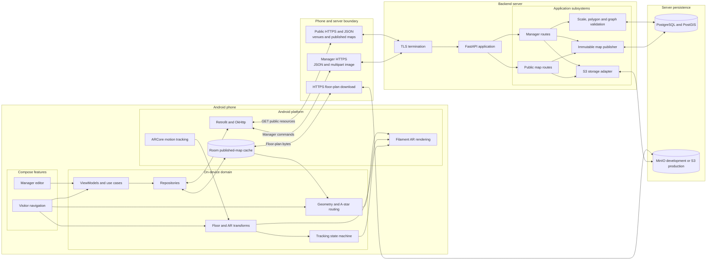
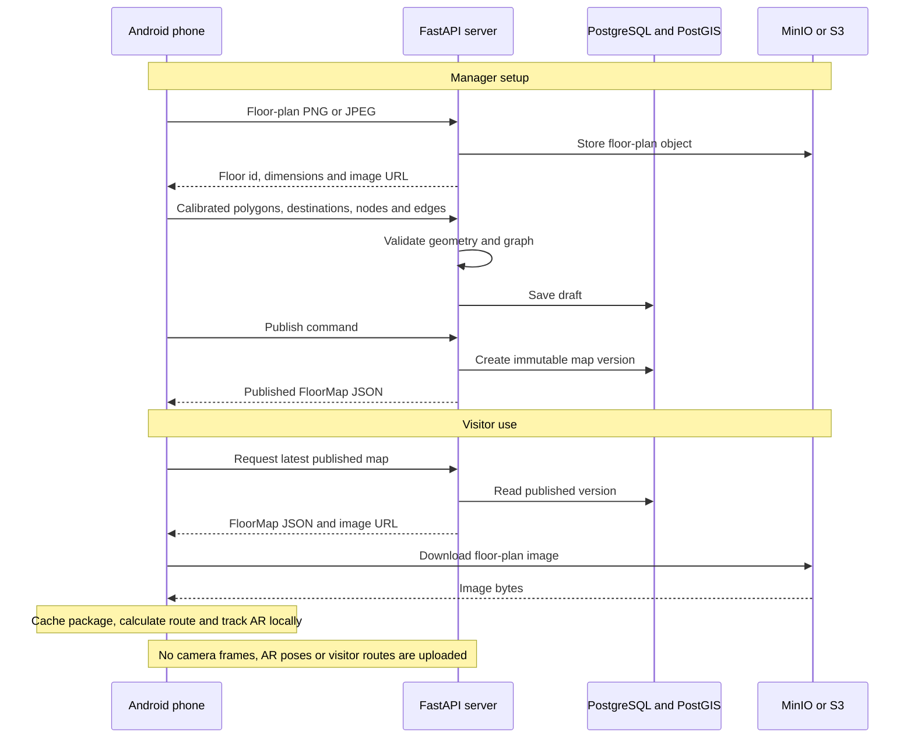

# Phone-to-server technical architecture

## What crosses the boundary

The server is responsible for map validation, image storage, and immutable publishing. The phone is responsible for caching, route calculation, start-position confirmation, ARCore tracking, coordinate transforms, and rendering. The internal MVP has no credential subsystem.
